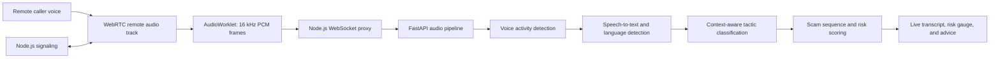

# ScamChain AI

### Hear the warning before the money moves.

ScamChain is a real-time voice-call safety prototype for detecting social-engineering scams. It listens to the **other caller’s audio**, transcribes what they say, recognizes scam tactics and their order, then turns that evidence into a live risk score and a clear next step.

> **Demo:** a caller impersonates a police or bank official, creates fear or urgency, and asks for an OTP. ScamChain surfaces the transcript, detected tactics, rising risk, and an alert while the call is still in progress.

## The problem

Voice scams work by manipulating people in real time. A caller may impersonate an authority, invent an emergency, keep the victim on the phone, and then ask for an OTP, a payment, or access to the device. Each request can sound plausible on its own, and people are often pressured to act before they have time to verify it.

Most call interfaces show who is calling, but they do not help explain **what the caller is doing**. ScamChain explores how live speech analysis can give people a timely, understandable warning during the conversation.

## The solution

ScamChain is a browser-to-browser voice calling app with an AI Scam Shield. During a call, the app sends the remote caller’s audio to a speech and risk pipeline. The pipeline builds a transcript, detects tactics such as impersonation, threats, urgency, OTP requests, KYC fraud, remote access, and money transfers, and follows how those tactics escalate across the conversation.

The result is a 0–100 risk score, a Low/Medium/High/Critical level, evidence-linked tactic chips, and practical guidance such as verifying the caller independently or not sharing a code. Risk is based on the **caller’s transcribed words and conversation sequence**; the project does not claim to identify a scam from a voiceprint or emotion.

## What makes it different

- **Understands the conversation arc:** combines multiple caller tactics and known scam flows, instead of treating each phrase as an isolated keyword.
- **Analyzes the caller, not the recipient:** the AI audio graph uses the remote caller’s track, so the victim’s speech does not drive the scam score.
- **Designed for Indian scam patterns:** includes Hindi, Marathi, English, and Hinglish speech handling, with tactics covering digital-arrest threats, OTP harvesting, fake KYC, remote-access apps, and payment coercion.
- **Turns detection into action:** the interface shows a live transcript, the behaviors behind the score, and threat-specific advice, with sound and vibration alerts for critical warnings.
- **Uses Groq for AI classification:** speech recognition and risk scoring run in the local AI service; transcript text and conversation context are sent to Groq for tactic classification.

## How it works



1. **Connect:** Node.js serves the app and exchanges WebRTC call signaling. WebRTC carries the call audio between peers.
2. **Capture the caller:** The browser takes only the remote caller’s audio track, converts it to mono 16 kHz PCM, and streams short frames to the AI service over a WebSocket.
3. **Transcribe speech:** Silero VAD segments speech; faster-whisper transcribes the utterance and detects its language.
4. **Recognize behavior:** A multilingual classifier evaluates each utterance with recent call context. A pre-gate skips ordinary conversation when no suspicious pattern has appeared.
5. **Score the sequence:** The risk engine combines tactic confidence, tactic weights, escalation patterns, and a sensitive-request floor when an OTP or similar ask follows pressure.
6. **Explain the result:** The browser displays the transcript, detected tactics, risk level, and recommended action as the call continues.

## Demo flow

For a quick judging demo, use two devices or browser windows and two different IDs:

1. Open the same app URL on both devices. Register one as `1001` and the other as `1002`.
2. Call `1002` from `1001` and accept the call.
3. Have the caller say a short two-part example: first impersonate an authority and threaten arrest or account closure; then demand an OTP immediately.
4. Pause briefly between phrases so the speech segment can be transcribed. Watch the caller transcript, tactic chips, risk score, and alert update live.

The demo is illustrative: model output depends on audio quality, the selected language model, and the wording spoken.

## Run locally on Windows

### Requirements

- Node.js 18 or later
- Python 3.10 or later
- A Groq API key configured as `GROQ_API_KEY` in `ai/.env`

### Install

From this project folder:

```powershell
npm install
cd ai
python -m venv .venv
.\.venv\Scripts\Activate.ps1
pip install -r requirements.txt
if (!(Test-Path .env)) { Copy-Item .env.example .env }
cd ..
```

Set `LLM_PROVIDER=groq_free` and `GROQ_API_KEY` in `ai/.env`. If `ai/.env` already exists, preserve it instead of replacing it with the example. Keep the key private and do not commit it. No Ollama installation is needed.

### Start both services

```powershell
.\start.bat
```

This starts the calling app and signaling service on port `3000`, plus the AI service on port `8000`. The AI health endpoint is [http://localhost:8000/health](http://localhost:8000/health).

## Try it on phones

Phone browsers require HTTPS to grant microphone access. Keep using Cloudflare Tunnel for the mobile web link; it does not carry WebRTC call audio. For calls blocked by mobile or Wi-Fi NAT, Metered lists a 500 MB free TURN trial with no credit card required. Create a Metered TURN credential, then copy the username, password, and TURN URLs from its **Show ICE Servers Array** view. On the free plan, Metered documents `standard.relay.metered.ca` as the available region. Allow up to two minutes for a new credential to propagate. See [Metered's free trial details](https://www.metered.ca/pricing) and [credential setup guide](https://www.metered.ca/docs/turn-server-service/creating-turn-credentials/).

```powershell
$env:TURN_URLS = 'turn:standard.relay.metered.ca:80;turn:standard.relay.metered.ca:80?transport=tcp;turn:standard.relay.metered.ca:443;turns:standard.relay.metered.ca:443?transport=tcp'
$env:TURN_USERNAME = 'paste-metered-username'
$env:TURN_CREDENTIAL = 'paste-metered-password'
.\start.bat
```

The app loads these ICE servers from `/api/ice`. Keep the TURN username/password in the server environment, not frontend code. Cloudflare Realtime TURN remains supported if you already have a TURN key, through `CLOUDFLARE_TURN_KEY_ID` and `CLOUDFLARE_TURN_KEY_API_TOKEN`.

Install `cloudflared` from [Cloudflare's Windows downloads](https://developers.cloudflare.com/cloudflare-one/networks/connectors/cloudflare-tunnel/downloads/), then run it in a second PowerShell window:

```powershell
cloudflared tunnel --url http://localhost:3000
```

Open the generated `https://....trycloudflare.com` URL on the first phone. Open the same URL with `?id=1002` on the second phone, then call line `1002` from the first. The first phone uses line `1001` by default. Keep the app, AI service, and tunnel running during the call. The call screen reports whether TURN is configured and whether the active media route is direct or relayed. **Never commit TURN credentials or AI API keys.**

## Tests

Run the signaling server ICE configuration tests and deterministic risk tests from the project folder:

```powershell
npm run test:server
ai\.venv\Scripts\python.exe -m pytest ai\tests\test_pipeline.py -v
```

The pipeline tests cover benign calls, escalating scam flows, and the sensitive-request risk floor. For the end-to-end AI audio protocol test, see [`ai/tests/test_e2e_realtime.py`](ai/tests/test_e2e_realtime.py) and [`ai/tests/audio_replay.py`](ai/tests/audio_replay.py).

## Project structure

```text
server.js                 Express app, WebRTC signaling, AI WebSocket proxy, ICE config
public/index.html         Call UI, remote-audio capture, live transcript and risk display
public/pcm-worklet.js     Audio resampling and PCM frame generation
ai/main.py                FastAPI WebSocket and live analysis orchestration
ai/audio_stream_processor.py  VAD and utterance segmentation
ai/speech_to_text.py      Speech recognition and language detection
ai/tactic_classifier.py   Context-aware scam tactic classification
ai/sequence_analyzer.py   Multi-stage scam-flow matching
ai/risk_engine.py         Risk aggregation, levels, and smoothing
ai/alert_generator.py     Human-readable warnings and actions
```

## Scope and limitations

ScamChain is a prototype for a live browser call, not an integration with the phone’s native cellular dialer. Recognition and classification can be delayed or wrong, especially with noisy audio, accents, code-switching, or an unavailable language-model provider. A risk score is an aid to judgment, not proof that a caller is fraudulent or legitimate. Calls across restrictive networks require a working TURN service. Groq receives transcript text and conversation context; call audio is transcribed locally by the AI service.
